# Predictive Maintenance: Remaining Useful Life of Jet Engines

[](https://www.python.org/)
[](https://pytorch.org/)
[](https://scikit-learn.org/)
[](https://streamlit.io/)
[](tests/)
[](https://www.nasa.gov/intelligent-systems-division/discovery-and-systems-health/pcoe/pcoe-data-set-repository/)
[](LICENSE)

**From 21 sensor signals to an answer a maintenance planner can use: "pull engine #3 in about 16 cycles".**

This project predicts the **remaining useful life (RUL)** of turbofan engines using NASA's C-MAPSS
run-to-failure data. It then turns each prediction into a **maintenance decision** by picking the
alert threshold with the lowest expected cost, and compares that condition-based policy with
time-based preventive maintenance and with running to failure. I'm a manufacturing engineer, and
that last step is the one I care most about. A prediction is only worth something if it changes
when the wrench turns.

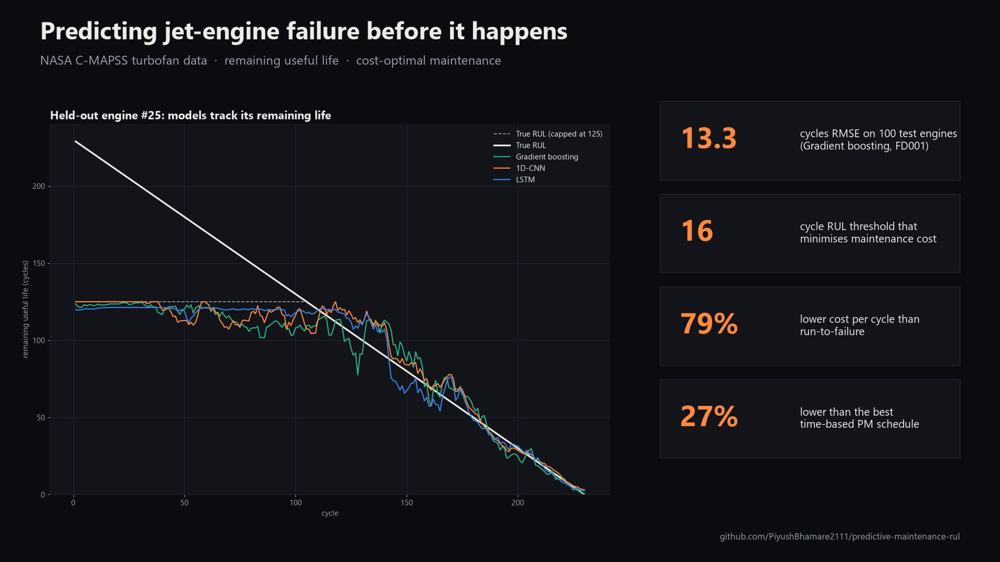

## Highlights

- **All four C-MAPSS subsets** (FD001–FD004, 709 training engines), scored on the **official test sets**
  with RMSE and the asymmetric **PHM08 score**.
- **Three models** trained in under a minute each on a laptop RTX 4060: gradient boosting on rolling-window
  features, a **1D-CNN**, and an **LSTM** (PyTorch, 3-seed ensembles).
- **Honest benchmarking.** The tuned baseline beats both deep nets on every subset, and all of my models are
  behind the best published deep CNN. Both facts are reported here as measured.
- **A maintenance decision layer.** On held-out FD001 engines, condition-based maintenance at the best
  threshold costs **$107 per operating cycle**. The best fixed-age schedule costs **$147** (27% more) and
  run-to-failure costs **$519**.
- **An interactive Streamlit app.** You can replay any engine's life, read its sensors, get a
  traffic-light recommendation, and adjust the cost assumptions to watch the best policy change.

## Pipeline

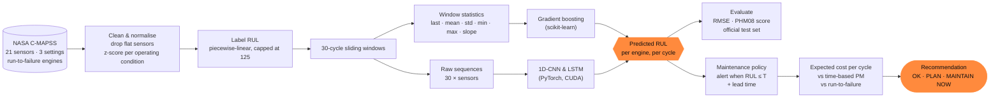

## Results

The test RMSE and PHM score are computed on the **official test sets** (one prediction per test engine,
at its last observed cycle) against the **uncapped** true RUL. The model never sees any test data during
training.

| Subset | Model | Test RMSE ↓ | PHM score ↓ | RMSE vs truth capped at 125 | Train time |
|---|---|---|---|---|---|
| FD001 | **Gradient boosting** | **13.27** | **261** | 11.97 | 4 s (CPU) |
| FD001 | 1D-CNN | 15.75 | 383 | 14.37 | 7 s (GPU) |
| FD001 | LSTM | 14.55 | 392 | 13.48 | 9 s (GPU) |
| FD002 | **Gradient boosting** | **25.80** | **7,374** | 13.27 | 3 s (CPU) |
| FD002 | 1D-CNN | 27.93 | 10,770 | 14.97 | 20 s (GPU) |
| FD002 | LSTM | 26.39 | 10,072 | 14.42 | 27 s (GPU) |
| FD003 | **Gradient boosting** | **15.02** | 506 | 13.40 | 2 s (CPU) |
| FD003 | 1D-CNN | 15.46 | **444** | 13.76 | 11 s (GPU) |
| FD003 | LSTM | 15.49 | 605 | 14.10 | 10 s (GPU) |
| FD004 | **Gradient boosting** | **26.26** | **4,469** | 14.04 | 3 s (CPU) |
| FD004 | 1D-CNN | 27.76 | 5,596 | 15.44 | 35 s (GPU) |
| FD004 | LSTM | 26.35 | 4,832 | 14.53 | 31 s (GPU) |

Deep-model train times cover all 3 ensemble seeds. Timings are from an RTX 4060 Laptop GPU and include
early stopping.

**Published reference values** (RMSE / score as reported by the authors):

| Method | FD001 | FD002 | FD003 | FD004 |
|---|---|---|---|---|
| CNN, Babu et al. 2016 | 18.45 / 1,287 | 30.29 / 13,570 | 19.82 / 1,596 | 29.16 / 7,886 |
| LSTM, Zheng et al. 2017 | 16.14 / 338 | 24.49 / 4,450 | 16.18 / 852 | 28.17 / 5,550 |
| DCNN, Li et al. 2018 | 12.61 / 274 | 22.36 / 10,412 | 12.64 / 284 | 23.31 / 12,466 |
| **This repo, best model** | **13.27 / 261** | **25.80 / 7,374** | **15.02 / 506** | **26.26 / 4,469** |

**What these numbers mean:**
- On **FD001**, the gradient-boosting baseline comes within 0.7 cycles RMSE of Li et al.'s deep CNN and
  has a slightly *better* PHM score. It is clearly ahead of the 2016 CNN and 2017 LSTM.
- On the **multi-condition subsets (FD002/FD004)**, my models are 3–4 cycles RMSE behind the best
  published result. Part of that gap is the uncapped test truth: many FD002/FD004 test engines have a true
  RUL far above 125, and a model trained on capped labels cannot predict those values. Against capped
  truth, the RMSE drops to about 13–14.
- Papers use slightly different protocols (window length, cap, how many runs they average, and whether
  the test truth is capped), so treat the published values as ballpark references. Heimes (2008), the
  runner-up of the PHM08 challenge, introduced the piecewise-linear RUL target used here.
- My 1D-CNN and LSTM are compact models that I did not heavily tune. With 80 training engines and roughly
  15 informative sensors, a tree model on well-chosen window features is hard to beat. In a plant that is
  a useful result too: the cheaper, more explainable model wins.

### Figures

**Sensor degradation.** Every engine starts healthy and drifts toward failure. Seven sensors are flat
in FD001 and get dropped automatically.
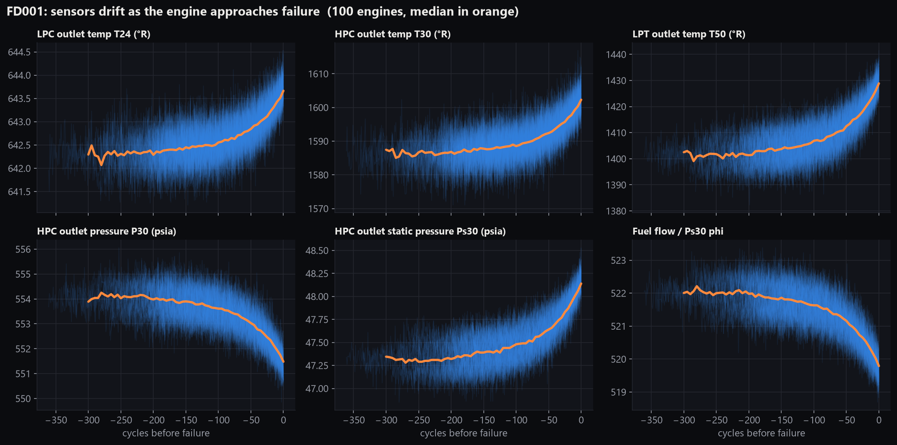
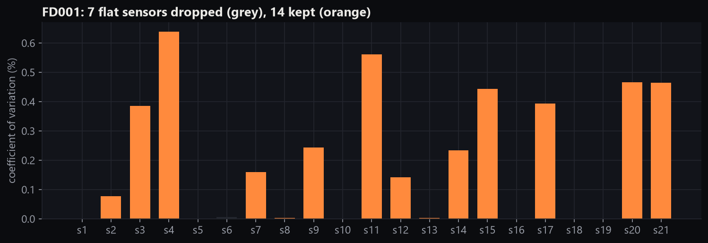

**Predicted vs true RUL on the official FD001 test set.**
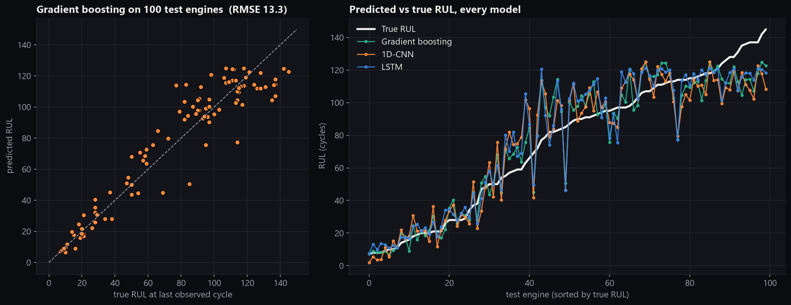

**RUL over an engine's whole life.** These are held-out engines that the models never trained on. The
models learn to say "healthy, about 125 cycles" early in life, then track the decline toward failure.
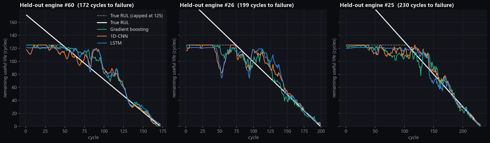

**Error distribution.** Late predictions (to the right of zero) are the dangerous ones, and the PHM score
penalises them exponentially harder.
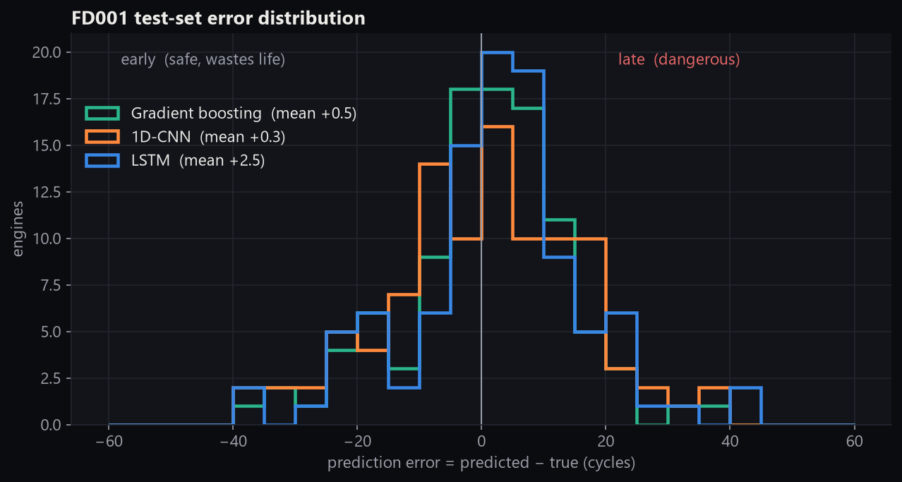

**Model comparison across all subsets.**
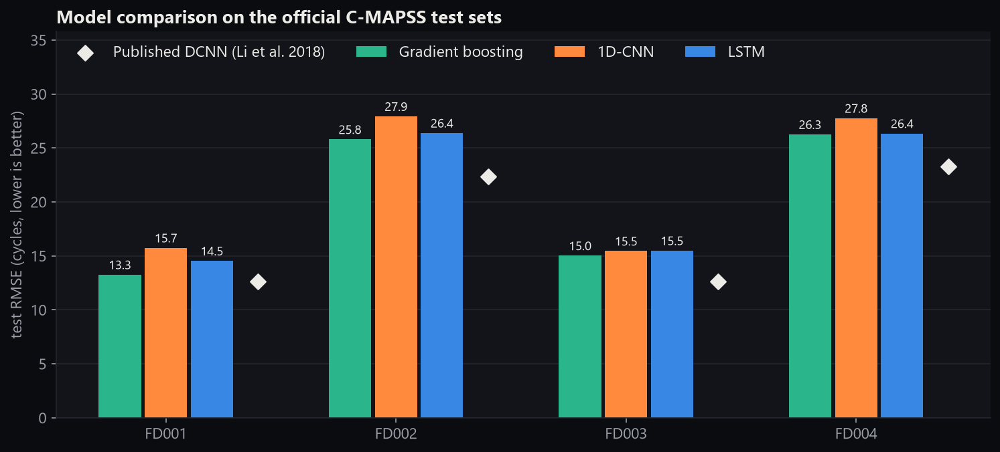

**Maintenance cost curve.** The cost model assumes an unplanned failure costs $100k, a planned replacement
costs $20k, and a job takes 10 cycles of lead time.
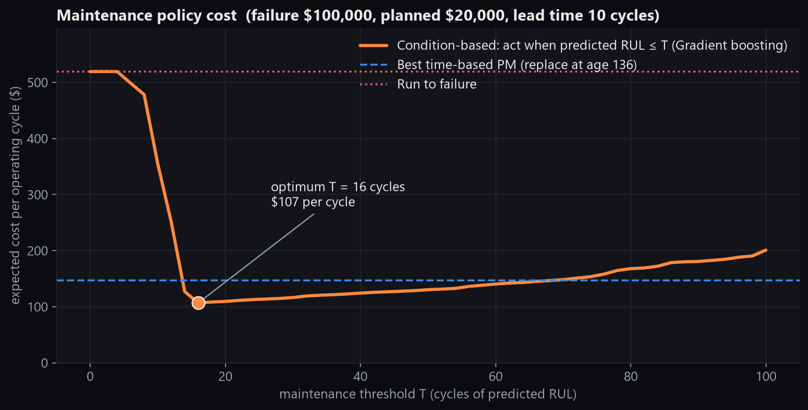
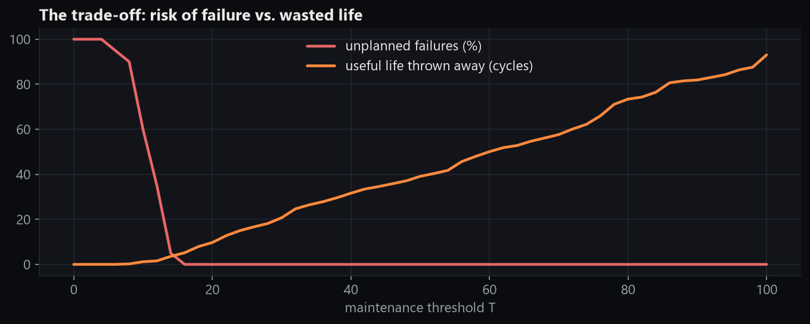

| FD001, 20 held-out engines | Cost per operating cycle | Unplanned failures |
|---|---|---|
| Run to failure | $519 | 100% |
| Best time-based PM (replace every engine at age 136) | $147 | 0% |
| **Condition-based, alert at predicted RUL ≤ 16** | **$107** | **0%** (≈5 cycles of life left on average) |

The same pattern holds on every subset (FD002: $102 vs $142; FD003: $89 vs $132; FD004: $85 vs $137).

## The app

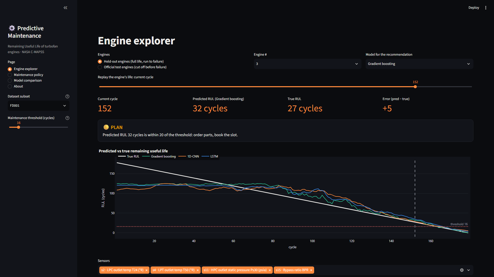

| Maintenance policy | Model comparison |
|---|---|
| 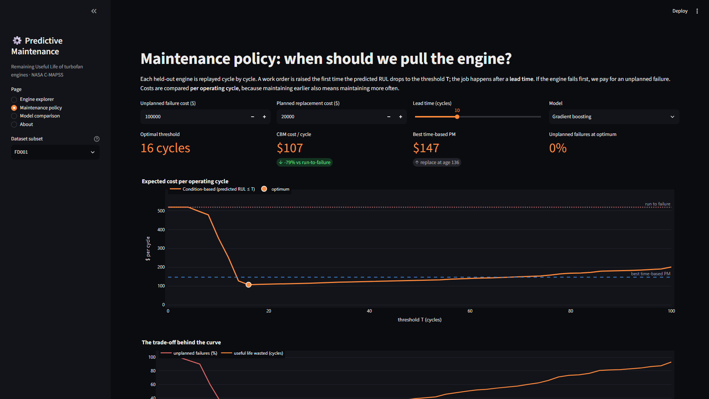 | 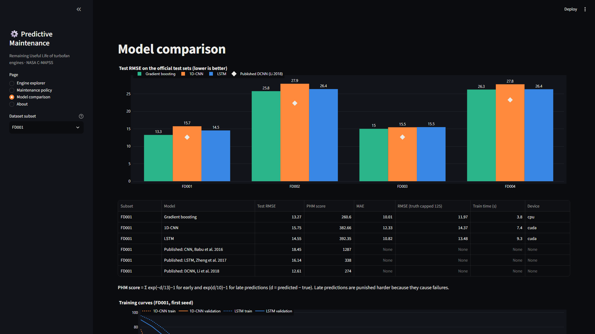 |

- **Engine explorer.** Pick a subset and an engine (a held-out run-to-failure engine or an official test
  engine). Drag a slider to replay its life. You see the predicted vs true RUL for all three models,
  sensor traces with a rolling mean, and an **OK / PLAN / MAINTAIN NOW** recommendation for the current
  cycle.
- **Maintenance policy.** Enter your own failure cost, planned-maintenance cost and lead time. The page
  re-simulates the fleet and shows the cost-optimal threshold against time-based PM and run-to-failure.
- **Model comparison.** Metrics for every subset and model next to the published values, plus the
  training curves.

The app loads the **committed model artifacts** in `models/` (about 8 MB). It needs only the downloaded
data, not retraining.

## How it works (plain words)

1. **The data.** NASA simulated a fleet of jet engines. Each one starts with a different amount of hidden
   wear and runs, flight after flight ("cycles"), until it fails. Every cycle records 21 sensors
   (temperatures, pressures, fan speeds) and 3 operating settings. The test engines are stopped some time
   before failure, and NASA gives the true number of cycles they had left.
2. **Cleaning.** Some sensors never change, so they are dropped. In FD002 and FD004 the engines fly at six
   different operating conditions (altitude, Mach number, throttle). Those conditions shift every reading,
   so I group the readings by condition and standardise each sensor *within* its condition. What remains
   is the wear signal.
3. **The target.** A new engine shows no measurable wear. Labelling it "300 cycles left" would ask the
   model to guess something the sensors cannot see. So the target is capped at 125 cycles and counts down
   linearly to 0 at failure.
4. **Features and models.** Each prediction looks at the last 30 cycles. The baseline condenses each sensor
   in that window into level, spread and trend (slope) and fits gradient-boosted trees. The deep models
   (1D-CNN and LSTM) read the 30×sensor window directly. The engines are split into training and held-out
   validation groups by engine, never by row, so no engine's future leaks into training.
5. **Scoring.** RMSE measures the typical error in cycles. The PHM08 score adds an asymmetric penalty: being
   10 cycles *late* costs more than being 13 cycles *early*, because a late call means a failure in service.
6. **The decision.** Replay each held-out engine. The first time the predicted RUL drops to T, raise a work
   order, which is executed after a lead time. If the engine fails first, that's an unplanned failure.
   Sweep T and pick the value with the lowest cost **per operating cycle**. That is the right unit
   (renewal-reward theory), because maintaining earlier also means maintaining more often.

## How this maps to a real plant

| Concept here | On the shop floor |
|---|---|
| Engine run to failure | An asset (pump, spindle, gearbox, compressor) whose failure modes you track in an **FMEA** |
| RUL prediction from sensors | **Condition-based maintenance (CBM)** fed by vibration, temperature, current or pressure data |
| Replace at fixed age | **Time-based PM.** The age is usually set from **MTBF** or the OEM manual, and it ignores how each unit is actually wearing |
| Cost curve and threshold T | The **P-F interval** trade-off: act after the potential failure (P) shows up but before functional failure (F) |
| Lead time | Parts lead time, crew scheduling, and waiting for a planned downtime window |
| Unplanned failure cost | Lost **OEE** availability, scrap, expediting and secondary damage |
| PHM score asymmetry | Why reliability engineers tolerate early calls but not missed failures |

The gap between time-based PM and CBM in the table above has a simple cause. A fixed-age policy must be
set conservatively, close to the *shortest* life in the fleet, so most units get replaced with a lot of
life left. A good RUL model lets each unit run close to its own end of life. That is the same argument
for moving a plant from calendar-based PM to condition monitoring.

## Run it yourself on Windows (step by step)

These steps were tested on Windows 11 with PowerShell and Python 3.12. Each command goes on its own line.

**1. Clone the repo**
```powershell
git clone https://github.com/PiyushBhamare2111/predictive-maintenance-rul.git
cd predictive-maintenance-rul
```

**2. Create a virtual environment.** If `python` isn't on your PATH, use the full path, for example
`& "$env:LOCALAPPDATA\Programs\Python\Python312\python.exe" -m venv .venv`.
```powershell
python -m venv .venv
```

**3. Activate it.** If PowerShell blocks the script, first run
`Set-ExecutionPolicy -Scope CurrentUser RemoteSigned` once.
```powershell
.\.venv\Scripts\Activate.ps1
```
Your prompt should now start with `(.venv)`.

**4. (Optional, NVIDIA GPU) Install CUDA PyTorch first**
```powershell
pip install torch==2.14.1 --index-url https://download.pytorch.org/whl/cu126
python -c "import torch; print(torch.__version__, torch.cuda.is_available())"
```
Skip this step to use the CPU build. Everything still works, and training just takes a few minutes longer.

**5. Install the dependencies**
```powershell
python -m pip install --upgrade pip
pip install -r requirements.txt
```

**6. Download the NASA C-MAPSS data** (about 12 MB, checksum-verified, saved to `data\CMAPSS\`)
```powershell
python scripts\download_data.py
```

**7. (Optional) Retrain the models.** Trained artifacts are already committed, so you can skip this.
```powershell
python scripts\train.py --fd all      # FD001-FD004, about 4 min on an RTX 4060
python scripts\train.py               # FD001 only
python scripts\train.py --device cpu  # force CPU
```
This step trains and evaluates on the official test set. It prints the results table and writes
`models\<FD>\metrics.json`, the model files, and the maintenance policy tables.

**8. (Optional) Regenerate the figures**
```powershell
python scripts\make_figures.py
```

**9. Run the tests**
```powershell
python -m pytest -q
```

**10. Launch the app**
```powershell
streamlit run app.py
```
Then open **http://localhost:8501** in your browser. Press `Ctrl+C` in the terminal to stop it.

## Tests

`pytest` runs 19 tests:
- **RUL labelling.** Linear countdown, the cap at 125, per-engine labels, and back-filling the test truth.
- **Windowing.** Window shapes `(N, 30, F)`, front-padding of short engines, and the slope feature on a known
  line.
- **Preprocessing.** Constant sensors are dropped and the preprocessor survives a JSON round-trip.
- **PHM score.** Hand-computed values, e.g. `d = -13 → e − 1`, `d = +10 → e − 1`, and late > early.
- **Maintenance.** Policy outcomes, the lead-time failure case, and the cost rate of the age policy.
- **Training smoke test.** Gradient boosting, the CNN and the LSTM each train for 1 epoch on a tiny
  synthetic fleet, save artifacts and reload them. No download is needed.
- **Streamlit AppTest.** Every page renders without exceptions, including switching subsets. These tests
  are skipped if the data isn't downloaded.

## Project structure

```
predictive-maintenance-rul/
├── app.py                  # Streamlit app (4 pages)
├── pdm/                    # the package
│   ├── data.py             # load C-MAPSS, RUL labelling, engine-level split
│   ├── features.py         # per-condition normalisation, sensor selection, windows, window features
│   ├── models.py           # gradient boosting baseline, 1D-CNN, LSTM, training loop, ensembles
│   ├── evaluate.py         # RMSE, PHM08 score, published reference values
│   ├── maintenance.py      # CBM / time-based / run-to-failure cost simulation, recommendations
│   ├── pipeline.py         # train → evaluate → decide → save / load artifacts
│   └── theme.py            # shared dark theme (#ff8a3d accent)
├── scripts/
│   ├── download_data.py    # fetch and verify NASA data (treated as untrusted, parse-only)
│   ├── train.py            # train and evaluate all models
│   └── make_figures.py     # README figures + 1920×1080 showcase images
├── models/FD00x/           # committed trained artifacts + metrics.json + policy tables
├── docs/                   # figures, app screenshots, docs/media/ showcase PNGs
├── tests/                  # pytest suite
├── requirements.txt
└── LICENSE
```

## Dataset and citation

A. Saxena, K. Goebel, D. Simon, N. Eklund. *"Damage Propagation Modeling for Aircraft Engine Run-to-Failure
Simulation."* International Conference on Prognostics and Health Management (PHM08), Denver, 2008.
The data is the **Turbofan Engine Degradation Simulation Data Set**, from the NASA Prognostics Center of
Excellence Data Set Repository, NASA Ames Research Center. `scripts/download_data.py` downloads it from
NASA's public PCoE bucket.

Other references: F. O. Heimes, *"Recurrent neural networks for remaining useful life estimation"*, PHM08;
X. Li, Q. Ding, J.-Q. Sun, *"Remaining useful life estimation in prognostics using deep convolution neural
networks"*, Reliability Engineering & System Safety 172 (2018); G. S. Babu, P. Zhao, X.-L. Li, DASFAA 2016;
S. Zheng et al., IEEE ICPHM 2017.

## Limitations and next steps

- The decision layer is tuned and evaluated on the same 20–52 held-out engines, and the fixed-age baseline
  is tuned the same way. Both numbers are therefore optimistic. Cross-validated thresholds would be more
  robust.
- The costs are illustrative. Plug in your own in the app.
- Possible next steps: condition-aware deep models for FD002/FD004, prediction intervals (quantile
  regression or MC dropout) so the threshold can be set on risk, and per-fault-mode analysis on FD003/FD004.

## License

MIT © Piyush Bhamare. See [LICENSE](LICENSE).
